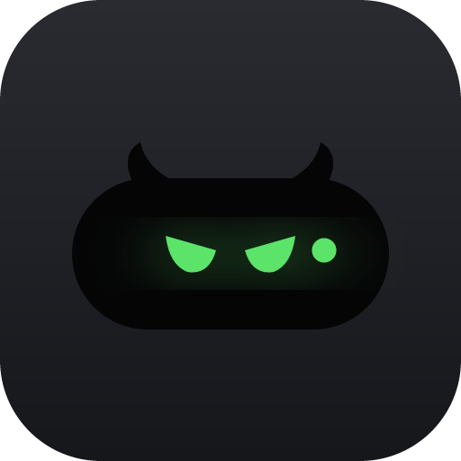
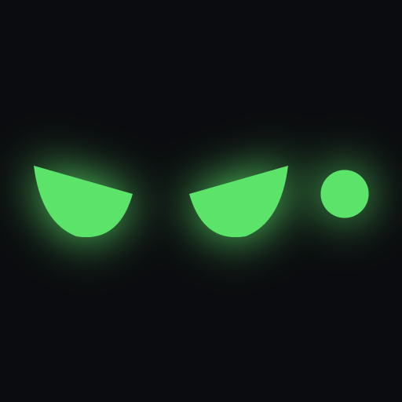

# Le logo de Mégatron

  
  &nbsp;&nbsp;&nbsp;
  

Ce document explique d'où vient le logo, comment il est construit, comment la mascotte s'anime dans l'application, et comment l'utiliser correctement.

---

## 1. L'idée

Mégatron vit dans une **encoche noire** collée en haut de l'écran. Le logo part de cette forme : l'encoche devient le **corps d'un petit robot**. Deux yeux verts s'allument à l'intérieur, et un **voyant** brille à côté, comme le témoin d'une machine en marche.

Le résultat est un personnage plutôt qu'un simple symbole. Il est déterminé, un peu espiègle, et fait penser à un compagnon de travail qui veille sur ta concentration. Il peut être bienveillant comme sévère selon la situation, et c'est exactement ce que fait la mascotte dans l'application.

**Le nom.** Une lecture possible : « Méga » (grand, puissant) et « -tron », le suffixe des machines électroniques (cyclotron, Tron). Mégatron serait une machine puissante qui travaille avec toi, posée en haut de ton écran. L'accent du « é » fait partie du nom.

**Point de vigilance.** « Megatron » est aussi le nom du chef des Decepticons dans *Transformers* (marque Hasbro) et celui d'un outil d'IA de NVIDIA. Le logo s'autorise un léger clin d'œil, un regard déterminé et de petites cornes, mais il ne reprend **aucun** élément de ces univers : pas d'insigne, pas de visage ni de silhouette du personnage. Toute évolution du logo doit respecter cette règle.

## 2. Anatomie

Le logo est fait de quatre éléments simples, dessinés séparément pour pouvoir être animés indépendamment :

- **Le corps** : une pilule noire aux extrémités arrondies, la forme de l'encoche.
- **Les cornes** : deux petites pointes courbes sur le dessus, qui donnent du caractère au robot sans le rendre menaçant.
- **Les yeux** : deux demi-lunes inclinées vers le centre. Leur bord supérieur droit et leur courbe en bas lui donnent un regard concentré, presque malicieux.
- **Le voyant** : un point lumineux à droite des yeux. Il indique que la machine est allumée et pulse quand elle travaille ou écoute.

Les yeux et le voyant sont entourés d'une **lueur** verte : ce sont les seules parties qui brillent.

## 3. Couleurs

| Rôle | Couleur | Code |
|---|---|---|
| Yeux, voyant, lueur | Vert Mégatron | `#5be36b` |
| Corps du robot | Noir profond | `#050506` (icône) · `#0b0c0f` (mascotte) |
| Fond de l'icône | Dégradé anthracite | `#2a2b31` → `#16171b` |
| Colère, distraction | Rouge alerte | `#ff4d4d` |
| Accent de l'interface (thème sombre) | Vert | `#4fe06a` |
| Accent de l'interface (thème clair) | Vert foncé | `#15803d` |

Le vert est la couleur de Mégatron : il signifie « allumé », « concentré », « tout va bien ». Le rouge est réservé aux moments où il est contrarié (distraction, budget dépassé).

## 4. Typographie

- **Outfit** pour le nom « Mégatron », les titres et les chiffres mis en avant : une police géométrique et ronde, assortie aux formes du robot.
- **Inter** pour tout le texte de l'interface : très lisible en petite taille.

Les deux sont libres de droits et intégrées à l'application.

## 5. Les versions

| Fichier | Usage |
|---|---|
| [`logo/megatron-icone.svg`](logo/megatron-icone.svg) · [`.png`](logo/megatron-icone.png) | **Icône complète** (robot sur fond arrondi). Icône de l'application, raccourcis, zone de notification. |
| [`logo/megatron-yeux-fond-noir.svg`](logo/megatron-yeux-fond-noir.svg) · [`.png`](logo/megatron-yeux-fond-noir.png) | **Yeux seuls sur fond noir.** Avatar (bot Telegram, profils), découpe ronde. |
| [`logo/megatron-yeux.svg`](logo/megatron-yeux.svg) · [`.png`](logo/megatron-yeux.png) | **Yeux seuls sur fond transparent**, à poser sur un fond sombre. En-têtes, présentations. |
| `src-tauri/icon.svg` → `src-tauri/icons/` | Source de l'icône de l'application, déclinée automatiquement en toutes les tailles (`npx tauri icon src-tauri/icon.svg`). |
| `src/components/Bot.tsx` | La **mascotte animée** de l'application, dessinée en code. |

Les fichiers SVG sont la référence : ils restent nets à toutes les tailles. Les PNG font 512 × 512 px.

## 6. La mascotte animée

Dans l'application, le logo devient un personnage vivant. Dans l'encoche, seuls ses yeux et son voyant apparaissent : **l'encoche elle-même sert de corps**. Ses yeux changent de forme selon ce qui se passe :

| Situation | Expression |
|---|---|
| Au repos | Yeux mi-clos (deux traits), qui s'ouvrent de temps en temps comme pour jeter un coup d'œil |
| Endormi (longue inactivité) | Yeux fermés, voyant atténué, petit « z » qui s'envole |
| Au travail (minuteur en cours) | Sourire des yeux |
| Focus | Le regard déterminé du logo |
| En pause | Yeux en arc, détendus |
| Content (fin de focus, conversation) | Sourire, avec sautillement et confettis à la fin d'un focus réussi |
| Méfiant, en colère (distraction) | Yeux froncés **en rouge**, et un léger tremblement quand il est fâché |
| Alerte, à l'écoute | Grands yeux ronds |
| En réflexion (l'IA travaille) | Trois points qui clignotent |
| Compte à rebours | Un anneau qui tourne à la place des yeux |

S'y ajoutent des détails qui lui donnent vie : il **cligne des yeux** de temps en temps, son regard **suit la souris**, et son voyant **pulse** quand il travaille, écoute ou surveille un focus. Pendant une conversation à la voix (« Hey Mégatron »), des **ondes colorées** s'animent à côté de ses yeux au rythme de la voix.

## 7. Règles d'utilisation

**À faire :**
- Utiliser l'icône complète pour représenter l'application, et la version « yeux seuls » pour les avatars et les petits formats.
- Garder un fond **sombre** derrière la version « yeux seuls » : le vert et sa lueur sont faits pour ressortir sur le noir.
- Laisser de l'air autour du logo : une marge au moins égale à la hauteur d'un œil.
- En dessous de 32 px, préférer la version « yeux seuls » : les cornes deviennent illisibles.

**À éviter :**
- Changer le vert des yeux, ou ajouter d'autres couleurs que le vert, le noir et le rouge d'alerte.
- Déformer, étirer ou faire pivoter le logo.
- Poser la version « yeux seuls » sur un fond clair ou chargé.
- Ajouter des éléments empruntés à *Transformers* ou à un autre univers existant.
- Retirer la lueur des yeux sur les grandes tailles : c'est elle qui donne l'impression que la machine est allumée.
